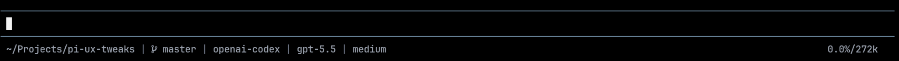

# Pi Footer

<a href="https://www.npmjs.com/package/@zigai/pi-footer"></a> <a href="https://www.npmjs.com/package/@zigai/pi-footer"></a> <a href="https://github.com/zigai/pi-tweaks/blob/master/LICENSE"></a>

A minimalistic, single-line replacement for Pi's footer.



Footer contents:

- current working directory
- git branch, with optional upstream ahead/behind counts
- provider and model
- thinking level
- MCP status
- session cost, when the model is billed through an API key
- context usage

Thinking levels use the omp five-square meter: `□□□□□ off`, `■□□□□ low`,
`■■□□□ medium`, `■■■□□ high`, `■■■■□ xhigh`, and `■■■■■ max`.
`minimal` also uses five empty squares. Existing theme colors and footer layout settings still apply.

Set `"thinkingStyle": "text"` in `~/.pi/agent/extension-settings/pi-footer.json`
to restore the original label, e.g. `GPT-6.1 Sol · medium`. The default is `"squares"`.

## Install

```sh
pi install npm:@zigai/pi-footer
```

<!-- pi-extension-settings:start -->
## Configuration

Global settings are stored in `~/.pi/agent/extension-settings/pi-footer.json`.

| Option               | Type                | Default          | Description                                                                                             |
| -------------------- | ------------------- | ---------------- | ------------------------------------------------------------------------------------------------------- |
| `separator`          | string              | `"·"`            | Text placed between visible footer slots.                                                               |
| `thinkingStyle`      | `squares` \| `text` | `"squares"`      | Thinking level appearance: five-square meter or the original text-only label.                           |
| `showGitAheadBehind` | boolean             | `false`          | Show upstream commit counts (↑ahead ↓behind) beside the branch. Hidden when the branch has no upstream. |
| `layout.left`        | string[]            | *See JSON below* | Footer slot IDs shown on the left in display order.                                                     |
| `layout.right`       | string[]            | *See JSON below* | Footer slot IDs shown on the right in display order.                                                    |
| `layout.hidden`      | string[]            | `[]`             | Footer slot IDs hidden from both sides.                                                                 |

```json
{
  "$schema": "./schemas/pi-footer.schema.json",
  "separator": "·",
  "thinkingStyle": "squares",
  "showGitAheadBehind": false,
  "layout": {
    "left": [
      "path",
      "branch",
      "provider",
      "model",
      "thinking"
    ],
    "right": [
      "cost",
      "context"
    ],
    "hidden": []
  }
}
```
<!-- pi-extension-settings:end -->

## Extension API

Other extensions can register custom footer slots through `@zigai/pi-footer/api`.

```ts
import { registerFooterSlot } from "@zigai/pi-footer/api";

const status = registerFooterSlot({
  id: "my-extension.status",
  defaultSide: "right",
  text: "ready",
});

status.setText("working");
status.clear();
status.dispose();
```

## License

MIT
