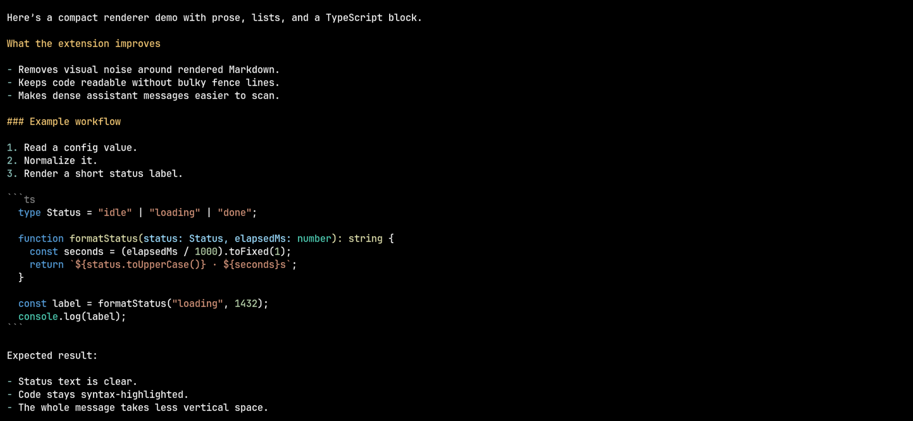
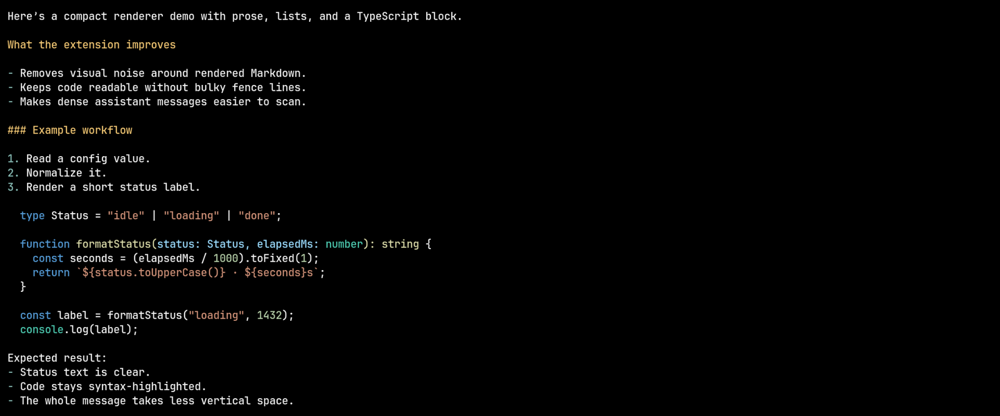

# Pi Response Renderer

<a href="https://www.npmjs.com/package/@zigai/pi-response-renderer"></a> <a href="https://www.npmjs.com/package/@zigai/pi-response-renderer"></a> <a href="https://github.com/zigai/pi-tweaks/blob/master/LICENSE"></a>

Compact assistant response rendering for Pi.

It applies a few small rendering tweaks:

- hides the visible ``` fence lines around rendered Markdown code blocks in assistant messages
- collapses paragraph gaps without squeezing tables or headings
- removes italic ANSI styling from assistant message output
- renders tables with teal headers, open column gaps and segmented row rules

## Install

```sh
pi install npm:@zigai/pi-response-renderer
```

The extension only changes how messages are rendered in the UI. It does not rewrite saved conversation content.

Set `tableRenderer` through Pi Extension Settings and reload Pi to apply it. Extensions can register another implementation with `registerTableRenderer(name, renderer)` and select it with `selectTableRenderer(name)` from this package. Registration handles update or dispose the renderer; disposal restores the previous available selection or Codex. Tables, fences and response spacing work without Glowup.

## Screenshots

Before:



After:



## License

MIT

<!-- pi-extension-settings:start -->
## Configuration

Global settings are stored in `~/.pi/agent/extension-settings/pi-response-renderer.json`.

| Option | Type | Default | Description |
| --- | --- | --- | --- |
| `tableRenderer` | string | `"codex"` | Selected table renderer: codex, native, or an extension-registered name. |
| `nativeTableBorderStyle` | `normal` \| `dim` | `"dim"` | Border style for native assistant tables: normal or dim. |
| `tableHeaderColor` | string | `"#5CCCCC"` | Color of table headers and their underline. |

```json
{
  "$schema": "./schemas/pi-response-renderer.schema.json",
  "tableRenderer": "codex",
  "nativeTableBorderStyle": "dim",
  "tableHeaderColor": "#5CCCCC"
}
```
<!-- pi-extension-settings:end -->
